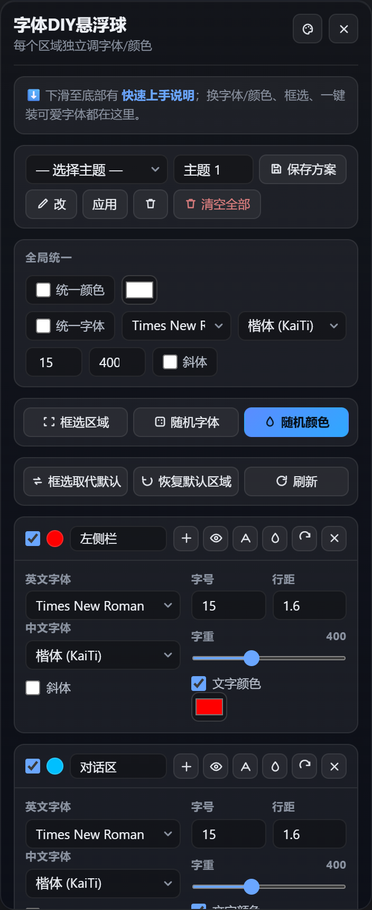

# dsh-font-enhancer

> 按区域自定义 DSH 界面字体、字号、行距、字重、斜体与文字颜色；支持框选建区、全局统一、主题保存切换、随机配色、一键安装可爱字体，并与另外两个悬浮球共享 128 款皮肤。

> DIY your DSH UI typography **per region** — font family, size, line-height, weight, italic
> and colour, plus box-select region creation, unified overrides, themes, random
> generation, one-click cute-font install, and a 128-skin catalogue shared with the
> other two floating balls.

**DSH 的界面长什么样，你说了算。** / **You decide what DSH looks like.**




> 面板实拍：顶部主题选择与保存、全局统一（颜色 / 字体 / 字号 / 字重 / 斜体）、框选区域 / 随机字体 / 随机颜色、框选取代默认 / 恢复默认区域 / 刷新，以及每个区域展开后的独立属性（英文字体、中文字体、字号、行距、字重滑块、斜体、文字颜色）。
>
> The live panel: theme picker, unified colour/font/size/weight/italic, pick-region / random font / random colour, replace-defaults / restore-defaults / refresh, and each region's expanded attributes (English and Chinese font, size, line-height, weight slider, italic, text colour).

---

## 目录 Table of contents

- [它到底能做什么 What it actually does](#它到底能做什么-what-it-actually-does)
- [功能清单 Feature list](#功能清单-feature-list)
- [10 个内置区域 The 10 built-in regions](#10-个内置区域-the-10-built-in-regions)
- [面板怎么用 Using the panel](#面板怎么用-using-the-panel)
- [框选区域详解 Box-select in detail](#框选区域详解-box-select-in-detail)
- [字体系统 Font system](#字体系统-font-system)
- [皮肤系统 Skin system](#皮肤系统-skin-system)
- [设置页分区 Settings-page section](#设置页分区-settings-page-section)
- [数据存在哪 Where data lives](#数据存在哪-where-data-lives)
- [安装 Install](#安装-install)
- [原理 How it works](#原理-how-it-works)
- [常见问题 FAQ](#常见问题-faq)
- [文件结构 File structure](#文件结构-file-structure)
- [更新日志 Changelog](#更新日志-changelog)
- [支持 Support](#支持-support)
- [License](#license)

---

## 它到底能做什么 What it actually does

一句话：**给 DSH 界面上的每一块文字单独决定长什么样，并且活过重启。**

In one line: **decide how every block of text in the DSH UI looks — independently — and
have it survive restarts.**

具体做的事（全部来自代码实测，不是设想）：

| 能力 | 说明 |
|---|---|
| 按区域设置 | 内置 10 个预校准区域，每个区域独立设置中文字体 / 英文字体 / 字号 / 行距 / 字重 / 斜体 / 文字颜色 |
| 框选建区 | 在实时页面上直接点选/框选元素，合并成一个自命名区域，无需写 CSS 选择器 |
| 全局统一 | 「统一颜色」「统一字体」「统一斜体」三个开关，一次设置套用到所有启用区域 |
| 主题方案 | 把整套配置存成命名方案，随时应用 / 重命名 / 删除 / 清空 |
| 随机生成 | 🎲 随机字体、🎨 随机配色（黄金角高区分度取色） |
| 字体安装 | 8 款字体一键安装（带实时进度）：**Comic Neue 随包内置**，其余 7 款首次安装时下载；也可上传自己的 .ttf/.otf |
| 皮肤 | 与 dsh-todo-float-ball / dsh-skill-browser 共享 128 款悬浮球皮肤，三球实时同步 |
| 持久化 | localStorage 为主、宿主 `settings.json` 为备份，双写回读；跨刷新、跨重启、跨版本升级保留 |
| 双端 | DSH 网页端（浏览器）与桌面端（Electron）均可用 |

---

## 功能清单 Feature list

### 1. 区域样式 Per-region styling

每个区域一张卡片。卡片头部左起：**☑ 复选框 + 颜色圆点 + 可编辑的区域名输入框**，右侧 6 个等宽图标按钮（纯图标，中文说明在悬停提示里）：

| 按钮 | 作用 |
|---|---|
| ➕ add | 框选更多元素追加到这个区域 |
| 👁 scope | 高亮显示该区域覆盖的元素范围 |
| A font | 只随机这个区域的字体 |
| 💧 color | 只随机这个区域的颜色 |
| ⟳ reset | 重置这个区域回到默认 |
| ✕ del | 删除这个区域 |

勾选复选框 → 卡片展开，分左右两列：

- **左列**：中文字体下拉、英文字体下拉
- **右列**：字号、行距、字重（100–900）、斜体开关、文字颜色取色器

修改立即生效，无需保存按钮。

### 2. 全局统一 Unified overrides

| 开关 | 作用 |
|---|---|
| 统一颜色 | 一个取色器应用到**所有启用区域** |
| 统一字体 | 一种字体 + 字号应用到**所有启用区域** |
| 统一斜体 | 一个开关应用到**所有启用区域** |

统一开关开启时，随机按钮改变的是「统一值」本身，而不是各区域各自的值——这是设计行为，不是 bug。

### 3. 主题方案 Theme presets

- **保存**：把当前全部区域的完整配置（字体 + 颜色 + 尺寸 + 统一状态）存成一个命名方案
- **应用**：下拉选中 → 点「应用」一键还原
- **重命名**：输入新名字 → 点 ✏
- **删除**：删除选中的单个方案，或「删除所有已保存的主题」清空
- 方案存在 localStorage，**跨重启与插件版本升级保留**

### 4. 随机生成 Random generation

- **🎲 随机字体**：给所有启用区域随机分配中/英文字体
- **🎨 随机颜色**：按黄金角步进生成高区分度配色，保证相邻区域颜色不撞
- 每个区域卡片上还有独立的 🎲 / 🎨 按钮，只作用于该区域

### 5. 字体安装 Font installation

提供 8 款可一键安装的字体（带下载进度条）。**注意：随安装包内置的只有 Comic Neue 一款**（56 KB，随包分发、离线可用）；其余 7 款首次点「一键安装」时从官方源下载到本机，不占安装包体积：

| 字体 | 类型 | 来源 |
|---|---|---|
| Comic Neue | 英文手写 | **随包内置**，无需联网 |
| 霞鹜文楷 LXGW WenKai | 中文手写 | 首次安装时下载（约 19 MB） |
| 得意黑 Smiley Sans | 中文动感 | 首次安装时下载 |
| 站酷快乐体 ZCOOL KuaiLe | 中文圆润 | 首次安装时下载（约 1.5 MB） |
| Baloo 2 | 英文圆润 | 首次安装时下载（可变字体） |
| Fredoka | 英文柔和 | 首次安装时下载（可变字体） |
| Nunito | 英文圆角 | 首次安装时下载（可变字体） |
| Caveat | 英文手写 | 首次安装时下载（可变字体） |

安装会做两件事：把 `.ttf` 复制进 `%LOCALAPPDATA%\Microsoft\Windows\Fonts`（免管理员），并写入 `HKCU\...\CurrentVersion\Fonts` + 调 `AddFontResourceW` 广播 `WM_FONTCHANGE`，让系统其它程序也能用。同时插件会用 `@font-face` 把该文件直接喂给页面，**所以装完立刻生效，不必等系统字体枚举**。

另外支持「📁 添加自提供安装包」：选本地 `.ttf` / `.otf` 文件 → 自动校验 → 安装并加入字体下拉。

> v1.5.3 之前：字体只被复制进用户字体目录、**从未写入注册表也从未加载**，所以「装好了但选了一点变化都没有」；且 4 个 Google Fonts 下载地址指向已不存在的 `*-Regular.ttf`（返回 404），得意黑的 release 地址同样失效。

### 6. 面板 UI Panel UI

- 右下角 **Aa** 悬浮球，可拖动换位置（像桌宠一样）
- 拖到屏幕外找不到时，设置页有 **🎯 一键恢复悬浮球默认位置**
- 悬浮球可隐藏/显示（在 DSH 设置页的「悬浮球导航」分区里控制）
- 所有保存/应用/删除操作走 **toast** 提示，不弹 alert
- **🔄 刷新** 按钮：重新注入样式，新装的字体立即生效
- 面板自身字体固定为楷体，避免被插件自己的规则影响

### 7. 采集模式 Recording mode（调试用）

面板上的 **🔴 采集区域** 按钮。开启后，每次框选/加元素都会把被选元素的稳定定位路径（`data-slot` 优先）写入日志文件，方便插件作者校准新区域的默认选择器。日常使用无需开启。

---

## 10 个内置区域 The 10 built-in regions

全部用 **`data-slot` 稳定属性**定位，不受 DSH 前端 CSS-Modules 哈希类名变化影响：

| # | 区域名 | 定位选择器 | 分组 |
|---|---|---|---|
| 1 | 左侧栏 | `[data-slot="sidebar"]` | 左侧栏 |
| 2 | 对话区 | `[data-slot="markdown"], [data-slot="conversation.chat.node"] > div` | 对话区 |
| 3 | 对话栏上方 | `[data-slot="conversation.session.header"]` | 对话区 |
| 4 | 输入区 | `[data-slot="conversation.composer"]` | 对话区 |
| 5 | todo进度 | `[data-slot="conversation.input.dock"]` | 对话区 |
| 6 | 工作区 | `[data-slot="sidebar.workspaces"]` | 左侧栏 |
| 7 | 对话信息显示 | `[data-slot="conversation.session.header.utilities"], [data-slot="conversation.session.header.actions"]` | 对话区 |
| 8 | 品牌标识 | `[data-slot="sidebar.brand.mark"], [data-slot="sidebar.brand.name"]` | 左侧栏 |
| 9 | 底部左侧边栏 | `[data-slot="sidebar.footer.action"]` | 左侧栏 |
| 10 | 底部对话信息栏 | `[data-slot="conversation.composer.dock"], [data-slot="conversation.composer.bar"] > div:nth-of-type(1) > div:nth-of-type(2)` | 对话区 |

> 第 10 项「底部对话信息栏」为 v1.5.2 新增。选择器可在卡片中查看与编辑；自己框选的区域追加在内置区域之后。

---

## 面板怎么用 Using the panel

1. 点右下角 **Aa** 悬浮球打开面板
2. 顶部：主题下拉 + 名称输入框 + **💾 保存配置方案** / **应用选中主题** / ✏ 重命名 / ✕ 删除选中主题
3. 中部：**全局统一** 三个开关（统一颜色 / 统一字体 / 统一斜体）+ **🖱 框选区域** + **🎲 随机字体** + **🎨 随机颜色** + **🔄 刷新**
4. 下部：按区域排列的卡片，勾选展开该区域设置
5. 底部：可爱字体一键安装列表 + 「📁 添加自提供安装包」

### 三个典型场景

**想给整个界面换一种字体？**
→ 勾选「统一字体」→ 选中文/英文字体 → 全站立即统一。

**只想改输入框的字号？**
→ 找到「输入区」卡片 → 勾选复选框 → 右列改字号/字重。

**想调一个内置区域没覆盖的地方？**
→ 点「🖱 框选区域」→ 在页面上点选元素（可多选）→ 起名字 → 确定 → 生成一张新卡片 → 照常调字体/颜色。

---

## 框选区域详解 Box-select in detail

**操作**：点「🖱 框选区域」→ 鼠标移到页面上，可点的元素会显示绿色描边 → 点击选中（可连续多选，面板上实时显示「已选 N 个元素」）→ 输入区域名字 → 确定。

**结果**：生成一个自定义区域卡片，与内置区域完全平权，可调字体/颜色/尺寸，可被主题方案保存。

**定位方式**：插件会为选中元素计算**稳定定位路径**（优先 `data-slot`，其次语义属性，最后才是结构路径），所以 DSH 升级、类名 re-hash 之后依然能命中。

**三个相关操作**：

| 操作 | 作用 |
|---|---|
| ➕ 框选更多 | 在已有区域卡片上「框选更多元素追加到这个区域」（`pickAdd`） |
| 🖱 高亮 | 在页面上高亮显示该区域当前覆盖了哪些元素，并提示「该区域覆盖 N 个元素」（`showScope`） |
| 框选取代默认 | 删除全部内置区域，只保留你框选的区域（`replacePicked`） |
| 恢复默认区域 | 删除新增的框选区域，恢复 10 个内置区域（`restoreDefault`） |

**匹配不到时**：卡片会显示「该区域当前未匹配到任何元素（可能已失效）」，提示选择器需要重新校准。

**跨重启存活**：框选区域与内置区域一起保存在 localStorage 与宿主 `settings.json`；v1.5.2 修复了「重启后自定义区域丢失内置区域」的问题。

---

## 字体系统 Font system

- **中文字体 18 款**：楷体、微软雅黑、微软雅黑 Light、宋体、黑体、新宋体、仿宋、等线、等线 Light、华文细黑、华文宋体、华文中宋、华文楷体、华文行楷、隶书、幼圆、方正舒体、方正姚体
- **英文字体 18 款**：Times New Roman、Arial、Calibri、Cambria、Georgia、Verdana、Tahoma、Segoe UI、Garamond、Book Antiqua、Palatino Linotype、Trebuchet MS、Lucida Sans Unicode、Comic Sans MS、Consolas (mono)、Courier New (mono)、Impact、Bahnschrift
- 列表与 Microsoft Word 对齐，装的字体如果系统已存在会自动复用
- 一键安装的 8 款字体（Comic Neue 随包内置，其余 7 款首次安装时下载）会追加到下拉列表里
- **默认值**：英文 Times New Roman、中文楷体

---

## 皮肤系统 Skin system

字体球的皮肤与 **dsh-todo-float-ball**、**dsh-skill-browser** 共享同一套目录（`window.__DSH_BALL_SKINS`），共 **128 款**：

| 分类 | 数量 |
|---|---|
| 招牌特效 | 28 |
| 浓郁深底 | 38 |
| 尘埃灰调 | 20 |
| 柔光深底 | 15 |
| 中性点缀 | 10 |
| 浅色纸面 | 17 |
| **合计** | **128** |

- 任一处切换，三个悬浮球与其展开面板颜色**实时同步**
- 「原版 · 暖极光（仅本球）」选项可让字体球单独回到原始外观，不影响另两球
- 切换入口：面板 🎨 按钮，或 DSH 设置页的「悬浮球导航」分区

---

## 设置页分区 Settings-page section

插件在 DSH 设置页注册了一个 **「悬浮球导航」** 分区（走官方 `settings.section` 槽位）：

- 若已安装 **dsh-skill-browser**：本分区自动让位，改由技能浏览器提供更完整的悬浮球导航
- 若未安装：本分区提供悬浮球显隐开关 + 推荐插件列表（实时显示「已安装 / 未安装」，未安装的可点 ⭐ Star 跳仓库）
- 分区里还有 **🎯 恢复悬浮球默认位置**

---

## 数据存在哪 Where data lives

| 存储 | 内容 | 位置 |
|---|---|---|
| localStorage | 区域配置、主题方案、统一状态、皮肤选择、采集模式开关 | 浏览器/渲染进程 |
| 宿主 settings.json | 同一份配置的备份 | `~/.dsh/data/dsh-font-enhancer/settings.json` |
| 已安装字体 | 下载/上传的字体文件 | 宿主字体目录，通过 `/dsh-font-enhancer/fonts/*` 提供 |

采用 **双写 + 回读**：桌面端每次重启 origin 会变，localStorage 可能是空的，此时从宿主 `settings.json` 回读恢复。

> 桌面端动态端口曾导致 localStorage 按 origin 隔离、配置"丢失"——这是 issue #1 的成因，现已由双写回读机制兜底。

---

## 安装 Install

```bash
# 从 DSH profile 目录：
dsh plugin --profile desktop add dsh-font-enhancer
```

或从插件市场搜「字体 / font-enhancer」安装。

### Requirements

- DSH 桌面端 2.0+，或 DSH 网页端
- Node ^22.19.0 或 >=24.0.0（宿主侧）

### 已知安装报错

若报错含 `minimumReleaseAge` 或 `ERR_PNPM_MINIMUM_RELEASE_AGE_VIOLATION`：

**这不是插件坏了。** 是 DSH 对刚发布 npm 包的 24 小时安全观察期（防投毒）。等一天再装即可通过，插件本体没有任何问题。作者连发多版时窗口期会顺延。

---

## 原理 How it works

**纯客户端插件**，无框架、无构建步骤。

**宿主侧**（`lib/index.js`，409 行）：`inject = ["webServer"]`，注册 11 条 loopback-only 路由：

| 路由 | 作用 |
|---|---|
| `/dsh-font-enhancer/health` | 健康检查 |
| `/dsh-font-enhancer/get` | 读取 settings.json |
| `/dsh-font-enhancer/set` | 写入 settings.json |
| `/dsh-font-enhancer/client-alive` | 客户端存活上报 |
| `/dsh-font-enhancer/log` | 客户端日志落盘 |
| `/dsh-font-enhancer/fonts/*` | 提供随包内置的字体文件 |
| `/dsh-font-enhancer/install-font` | 下载 + 安装 + 注册一款字体 |
| `/dsh-font-enhancer/font-progress` | 查询下载进度 |
| `/dsh-font-enhancer/upload-font` | 接收上传的 .ttf/.otf |
| `/dsh-font-enhancer/installed-fonts` | 列出本机已装字体（含全部别名），供客户端生成 `@font-face` |
| `/dsh-font-enhancer/user-font` | 直接吐出已装 .ttf，客户端用它做 `@font-face` 的 `src` |

**客户端**（`lib/client.js`，2698 行，`__ModuleLoader__` bundle）：

1. 生成 `<style>` 注入按区域的 CSS 规则
2. 用原生 DOM 渲染悬浮球与面板（无框架）
3. `MutationObserver` 监听 DOM 变化，框选区域的选择器失效时自动修复
4. localStorage 与宿主 API 双写
5. 皮肤：读取共享的 `window.__DSH_BALL_SKINS`，通过 `#dsh-fe-skin-style` 后置 `<style>` 覆盖（每条声明加 `!important` 赢得层叠）
6. 设置页分区：`ctx.slots.inject("settings.section", ...)` 注册
7. 已装字体：拉 `/installed-fonts` → 为每个别名胜生成 `@font-face`（`#dsh-fe-fontfaces`）→ 把已装的推荐项标成「✅ 已安装」

**CSS 定位策略**：内置区域**全部用 `data-slot` 稳定属性**，不用 CSS-Modules 哈希类名（如 `.mMKm6W_*`），避免 DSH 升级后失效。

---

## 常见问题 FAQ

### 样式不生效 / 插件卡住？

- 点面板上的 **🔄 刷新**
- 或点 DSH 左下角「重载」
- 或把 Aa 悬浮球收起来再展开（会重建插件）

### 装了新字体但下拉里没有 / 选了没变化？

- 先点面板上的 **🔄 刷新**（会重新拉 `/installed-fonts` 并注入 `@font-face`，一般立刻生效）
- 桌面端仍不生效：点 DSH 左下角「重载」
- 网页端（手机/其它电脑浏览器）：装的是**那台电脑**的字体，网页端不会同步；需要在那台机器上装，或按 **F5** 后重试
- 若 `✅ 已安装` 出现但字形仍是默认字体：多半是文件损坏（下载中断），把 `%LOCALAPPDATA%\Microsoft\Windows\Fonts\<文件名>` 删掉后重装一次

### 某区域颜色不对 / 互相串色？

- 检查是否有更宽的选择器（如 body 兜底）覆盖了它
- 内置 10 个区域的顺序按层叠优先级排列；自定义区域排在后面，同特异性下后列出的规则胜出
- 用「🖱 高亮」确认该区域实际覆盖了哪些元素

### 统一开关打开后随机没反应？

统一开关开启时，🎲/🎨 改的是**统一值本身**，不是各区域的值。这是设计行为——关掉统一开关才会分别改各区域。

### 主题保存后找不到？

保存成功会有 toast「已保存：xxx」。主题在下拉框里，选中后点「应用」切换。存在 localStorage，升级插件版本也不会丢。

### 面板字体为什么是楷体？

有意为之。固定楷体可以防止插件自身的 CSS 规则反向污染面板 UI，保证面板永远可读。

### 框选出来的区域重启后失效了？

v1.5.2 已修复两个相关问题：
1. 新增框选区域会导致内置区域全部丢失 → 已改为「内置区域 + 自定义区域」合并读取
2. 框选区域跨重启失效 → 已改为稳定路径定位 + 自动修复

若仍失效，用「🖱 高亮」看该区域匹配到几个元素；显示「未匹配到任何元素」说明 DSH 前端结构变了，需要重新框选。

---

## 文件结构 File structure

```
dsh-font-enhancer/
├── package.json          # 插件清单：dsh.bundle + dsh.client
├── cordis.patch.yml      # Cordis patch：注册 bundle
├── lib/
│   ├── index.js          # 宿主侧（409 行）：settings API + 字体安装/注册/上传
│   ├── client.js         # 客户端 bundle（2698 行）：全部 UI 与逻辑
│   └── fonts/ComicNeue.ttf  # 唯一随包内置的字体（其余 7 款按需下载）
├── locale/
│   ├── zh.json
│   └── en.json
├── docs/images/
│   └── font-enhancer-panel.png
├── README.md             # 本文件
├── README-zh.md / -es.md / -pt.md / -hi.md
├── CHANGELOG.md
├── LICENSE               # MIT
└── icon.svg
```

---

## 更新日志 Changelog

### v1.5.3 — 2026-10-23

- **修复（严重）**：一键安装的字体**从来没有真正生效过**。旧版只把 `.ttf` 复制进 `%LOCALAPPDATA%\Microsoft\Windows\Fonts`，既不写 `HKCU\...\Fonts` 注册表，也不调 `AddFontResourceW` —— 系统与 Chromium 都看不到它。现在安装流程补上「写注册表 → `AddFontResourceW` → 广播 `WM_FONTCHANGE`」，并且客户端额外用 `@font-face` 直接把文件喂给页面（新增 `/installed-fonts`、`/user-font` 两条路由），双保险。
- **修复**：5 个失效的字体下载地址。Google Fonts 已把 Baloo 2 / Fredoka / Nunito / Caveat 改为可变字体（`Xxx[wght].ttf`），旧的 `*-Regular.ttf` 全部 404；得意黑 release 只发 zip、无散装 ttf。现统一改走 jsDelivr 镜像（含 `@fontpkg/smiley-sans` 的 npm 包），逐个 GET 校验过 TTF magic。
- **改进**：字体目录新增 `family` 字段（真实家族名，从 TTF `name` 表读出），作为注册表值名与 CSS `font-family`；已装的推荐字体在面板里直接显示「✅ 已安装」并禁用按钮。
- **改进**：自备字体上传也会被注册进系统，并记录到 `~/.dsh/data/dsh-font-enhancer/user-fonts.json`，重启后别名不丢。
- **文档**：更正「内置 8 款」的说法 —— 实际随包内置只有 **Comic Neue 一款**，其余 7 款首次安装时联网下载。

### v1.5.2 — 2026-10-19

- **新增**：默认区域扩为 **10 项**，新增「底部对话信息栏」
- **修复**：新增框选区域后内置区域全部丢失（我自己在修 issue #1 时引入的回归）
- **修复**：框选区域跨重启失效
- 详见 [CHANGELOG.md](./CHANGELOG.md)

### v1.3.0

- 网页端 + 桌面端双端可用
- 一键下载安装可爱字体（带进度）、添加自提供安装包、刷新按钮
- 保存方案记住统一状态、字重与斜体

### v1.0.0

- 内置区域样式 + 统一控制 + 主题系统

---

## 支持 Support

发现 bug 或有功能建议？欢迎提 issue：
[GitHub Issues](https://github.com/loyalchiiina/dsh-font-enhancer/issues)

Found a bug or have an idea? Open an issue at
[GitHub Issues](https://github.com/loyalchiiina/dsh-font-enhancer/issues).

---

## License

MIT
