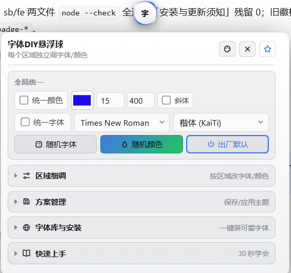

# dsh-font-enhancer · 字体DIY悬浮球

> DeepSeek Harness（DSH）插件：右下角一颗「字」悬浮球，点开字体 DIY 面板，整站字体 / 颜色 / 字号随你调。



## 功能

### 「字」悬浮球 + 字体DIY面板
- 右下角常驻一颗 34px 的「字」悬浮球，点击打开「字体DIY悬浮球」设置面板（副标题：每个区域独立调字体/颜色）。
- 面板按**区域**管理界面文字：每个区域可独立调整字体（中英文分选）、颜色、字号、字重（粗细）、斜体、行距。
- 内置 10 个常用区域（均按 `data-slot` 定位），还支持**框选**页面上的任意文字来新增/替换区域。
- 中文字体 18 款、英文字体 18 款可选；面板自身固定楷体，不被自己的设置影响。

### 全局统一区
- **统一颜色**：一键给所有已启用区域上色，默认 `#1E0BEA`。
- **统一字体**：英文字体与中文字体分开选择（例如英文 Times New Roman + 中文楷体）。
- 统一字号（**最小 8**，最大 22）、统一字重（100–900）、统一斜体。
- **随机字体 / 随机颜色**：一键把字体或颜色随机铺满所有区域。
- **出厂默认**：一键回到「未装插件」的状态——所有区域停用、两个全局统一关闭，插件不再改动任何页面字体（各区域已调过的设置仍保留）；再点一次退出出厂默认，全部区域重新勾选并自动勾上「统一颜色 + 统一字体」。出厂默认态下点随机按钮或勾选任意区域/统一项，会自动解除出厂默认（各区域勾选自动联动）。

### 四折叠栏
面板下半部分是四个可折叠区块：

1. **区域细调**（按区域改字体/颜色）：框选区域、框选取代默认、恢复内置区域、刷新；每个区域一张设置卡片。
2. **方案管理**（保存/应用主题）：把当前所有区域设置保存成方案，随时切换/重命名/删除/清空；另含 🎨 皮肤菜单入口。
3. **字体库与安装**（一键装可爱字体）：8 款一键安装字体——霞鹜文楷（LXGW WenKai）、得意黑（Smiley Sans）、站酷快乐体（ZCOOL KuaiLe）、Comic Neue（已内置）、Baloo 2、Fredoka、Nunito、Caveat；还支持上传自己的 `.ttf` / `.otf` 安装包。
4. **快速上手**（30 秒学会）：9 步图文指南，每步配黑白线性图标。

### 130 款皮肤 · 三球同步
- 🎨 皮肤菜单提供 **130 款**悬浮球皮肤，与技能浏览器球、Todo 进度球**同步换肤**（菜单首行可开关「三球皮肤同步」，也可仅本球单独换肤）。
- 内置 `0 · 随系统 · 深/浅自动`：跟随系统深浅色模式在官方深色 / 官方浅色之间自动切换。
- `129 · 官方深色`、`130 · 官方浅色` 两款官方皮肤**强制锁定字色**，保证与宿主界面一致。
- 皮肤按「浓郁深底 / 尘埃灰调 / 柔光深底 / 中性点缀 / 浅色纸面」分组，菜单三列排布方便浏览。
- 皮肤底色亮度自动判定（支持 hex / rgb / hsl），自动决定球面文字用深字还是白字。

### 面板外文字强制黑/白/自动
- 对插件面板之外被改色的文字，提供 **A（自动）/ ●（强制黑）/ ○（强制白）** 三档按钮，一键解决彩色底上看不清字的问题。

### 设置页「悬浮球导航」分区
- DSH 设置页新增「悬浮球导航」分区（本插件独立安装时）：字体球显隐开关、「◎ 回到右下角」复位按钮，以及作者插件推荐清单（含已装/未装标记）。
- 若已安装技能浏览器插件，该分区自动让位，避免重复。

## 效果图

### 设置页 · 悬浮球导航分区


## 安装

### 方式一：dsh 插件市场
在 DSH 内打开插件市场，搜索 `dsh-font-enhancer`（字体插件）即可一键安装。

### 方式二：npm
```bash
npm install dsh-font-enhancer
```

## 要求

- DSH >= 0.1.7-rc.1
- Node.js ^22.19.0 || >= 24.0.0

## 多语言 README

[简体中文](README.md)（本文件）· [हिन्दी](README-hi.md) · [Español](README-es.md) · [Português](README-pt.md)

## License

[MIT](LICENSE)
